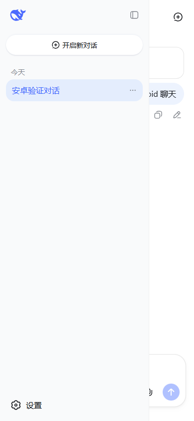

# DeepSeek CustomProvider

[English](README.md) | 简体中文

轻量 Android 聊天客户端，可自定义 **API Key、Base URL 和模型**。复用系统 WebView，通过原生 HTTPS 桥接访问 API，APK 约 **2 MB**，无需 Android Studio、Gradle 或模拟器。


## ❤️ 赞助商

> [想出现在这里？](mailto:support@sub2api.org)

<details open>
<summary>点击折叠</summary>

<table>
<tr>
<td width="180"><a href="https://zynk.top/sign-up?aff=DSCP"></a></td>
<td>感谢 Zynk API 赞助了本项目！<a href="https://zynk.top/sign-up?aff=DSCP">Zynk API</a> 是一个专注于速度与性价比的 AI API 网关平台，提供 Claude、OpenAI、Gemini、Kimi 等主流模型的 API 接入。<a href="https://zynk.top/sign-up?aff=DSCP">点此</a>以远低于官方 API 的价格使用快、稳、省的服务。</td>
</tr>

</table>

</details>

## 下载与使用

[下载 Android APK](https://github.com/Leyanshi/DeepSeek-CustomProvider/releases/latest) · [安装与构建详细说明](ANDROID.md)

支持 Android 8.0 及以上，推荐较新的系统 WebView，不依赖 Google Play 服务。v0.1.10 启动时检查 GitHub 最新正式 Release，发现新版后显示「更新版本： {version}」、完整且可滚动的更新日志和「打开 Release」按钮；获取失败时不提示。启动画面为居中的 DeepSeek LOGO 和灰色「加载中」，保留原生启动诊断和 TXT 导出，签名后逐个验证 APK 网页文件。手机上显示的应用名称为 **DeepSeek**。这是社区客户端，并非 DeepSeek 官方应用。

1. 从 Releases 下载 APK，传到手机安装。
2. 打开「设置 → 数据管理」，填写 API Key 和 HTTPS Base URL，点击「确定」保存。
3. 在「聊天模型」中获取模型列表并选择，或手动填写自定义模型 ID，再点击「确定」。
4. 在「联网与语音」中设置 Search/Fetch 和语音服务，可跟随聊天连接或使用独立服务；OpenAI 兼容语音可自定义 TTS 模型、识别模型和音色 ID。

v0.1.13 为手机左上角会话侧栏增加约 300 毫秒的滑入、滑出动画，背景遮罩同步淡入、淡出。点空白处、选择会话或按 Android 返回键都会平滑关闭；系统启用减少动画时关闭过渡。没有增加依赖。

v0.1.12 在「联网与语音 → 联网 API 来源」新增 **GrokSearch-rs (MCP)**。通过远程 Streamable HTTP 调用 `web_search` 和 `web_fetch`，将 Grok 整理摘要、来源链接和抓取的 Markdown 保留到聊天上下文与历史中。默认完整地址为 [GrokSearch-rs](https://github.com/Episkey-G/GrokSearch-rs) 公布的 `https://mcp.episkeyai.com/groksearch_rs/mcp`，也可填写自建 HTTPS MCP 地址。填写 Grok API Key，可选填与 Key 配套的 Grok 网关和搜索模型 ID；网关留空使用服务默认地址（通常为 xAI），模型留空使用服务默认模型。普通网页读取需要 Tavily、Exa、TinyFish 或 Firecrawl 来源 Key；GitHub、Wikipedia、arXiv 等专用读取器可免来源 Key。这些 Key 会提交给所填 MCP 服务，由它调用上游，不会自动沿用聊天 Key。手机无需安装 Rust 服务或额外 SDK。旧用户仍默认使用 DeepSeek，切换来源保留各自已保存的配置。

v0.1.11 支持图片直接放进聊天请求，实际调用 DeepSeek Search/Fetch 并将资料交给模型，修复 PCM/WAV/MP3 朗读和可配置的语音输入。模型声明或接口明确拒绝思考设置时，会自动省略不支持的参数。判断按地址与模型隔离，更换 Key 会清除旧判断并阻止旧请求迟到后重新写入；「数据管理」也提供手动重新检测入口。

新消息、编辑提问和重新生成使用当前所选模型，继续生成沿用原回答的模型。连接配置和模型会保留到下次启动。正式发布版本使用同一签名，可以覆盖安装旧版并保留本机数据。

更新检查使用 Android 原生网络在后台执行，版本号按数字比较。相同版本、旧版本、草稿、预发布版，以及断网、超时、限流和无效响应都不提示。关闭新版弹窗后，下次启动仍会检查；可从弹窗链接的 Release 页面下载 APK 覆盖安装。

若仍停在加载画面，请等待 15 秒，点击「查看 / 导出诊断 → 导出 TXT」。若复制后粘贴仍为空，可反馈保存的 `DeepSeek-startup-diagnostic.txt` 或诊断窗口截图。报告包含应用及 Android 版本、设备机型、WebView 版本、启动阶段和捕获的错误。重试保留本机聊天记录。用户手机上持续加载和粘贴为空的原因尚未确认。


## 运行

准备 Node.js 24 和 pnpm 12.21.0：

```sh
git clone https://github.com/Leyanshi/DeepSeek-CustomProvider.git
cd DeepSeek-CustomProvider
pnpm install
pnpm dev
```

打开 http://localhost:8090 。

生成静态产物：

```sh
pnpm build
```

产物位于 `dist/`，可部署到静态服务器，也可直接打开 `dist/index.html`。直接打开时，浏览器和 API 服务需允许 `file://` 页面的存储与跨域请求。

Android 打包使用 **Windows 和 JDK 11+**：

```powershell
corepack pnpm install --frozen-lockfile
corepack pnpm pack:android
```

通过 `JAVA_HOME` 或 `DS_ANDROID_JAVA_HOME` 指定现有 JDK。首次构建下载并校验 Google 官方的 Android 平台和构建工具归档，只保留约 48 MB 的必要文件到 `.android-tools/`，不会修改系统 PATH。产物位于 `release/DeepSeek-Android-<版本>.apk`。详见 [ANDROID.md](ANDROID.md)。

全新检出时会在 `android/.signing/` 生成本地签名密钥。保留该目录，才能让自己的后续构建覆盖安装；自行构建的 APK 与其他密钥签名的 APK 不能互相覆盖。签名密钥、下载工具和构建产物均从 Git 排除。GitHub Pages 工作流仅手动触发，运行前需在仓库设置中启用由 GitHub Actions 构建的 Pages。

## 功能

- 自定义 API Key 和 HTTPS Base URL，支持服务根地址、端口、路径前缀及 `/v1`。
- 使用正在填写的连接获取模型列表，支持选择模型或手动填写列表之外的模型 ID。
- 内置界面与 DeepSeek SVG 标识，白色圆角桌面图标和原生 Android HTTPS 桥接。
- 启动检查 GitHub 新版，显示完整可滚动更新日志，可跳转对应 Release 页面。
- 多会话、自动标题、重命名与删除；编辑提问、重新生成和切换消息分支。
- 流式回答、深度思考、智能搜索、链接阅读与来源引用；支持停止和符合条件的继续生成。
- 联网来源可选 DeepSeek Search/Fetch 或 GrokSearch-rs 远程 MCP，独立配置网关、模型和网页来源 Key。
- 附件上传、粘贴与拖拽，语音输入和回复朗读；移动端录音时输入框首行显示实时频谱。
- Markdown、代码高亮、KaTeX 公式和 Mermaid 图表。
- 简体中文与英文、浅色与深色主题、移动端布局、位置设置、历史导入导出。

## 数据

API Key 和设置保存在浏览器 localStorage，会话及附件原件保存在 IndexedDB，本地数据按浏览器用户配置和站点源（origin）隔离。发送对话、上传附件和使用语音功能时，相应内容会提交给配置的 API 服务。

设置中的历史导入导出使用 ZIP 格式。导入会在确认并校验成功后替换全部本地会话和附件；导出包含会话与本地可用的图片原件，不包含 API Key、设置或非图片附件原件。格式与保留范围见[历史导入导出](src/services/chat/history/README.md)。

设置 → 数据管理 → 删除所有对话，会在确认后清空全部本地会话、附件原件和未发送的草稿，停止正在生成的回复并回到新对话。API Key 和其他设置保留，已上传到 API 服务的文件不受影响。

## 开发

| 命令                        | 用途                         |
| --------------------------- | ---------------------------- |
| `pnpm dev`                  | 启动开发服务器               |
| `pnpm build`                | 网页构建到 `dist/`           |
| `pnpm pack:android`         | 构建并签名 Android APK       |
| `pnpm type`                 | TypeScript 类型检查          |
| `pnpm lint`                 | oxlint 检查                  |
| `pnpm test:models`          | 模型列表解析与自定义 ID 测试 |
| `pnpm test:grok-search`     | GrokSearch MCP 响应与来源测试 |
| `pnpm test:base-url`        | 前端与原生 URL 测试          |
| `pnpm test:android-assets`  | Android ZIP 路径与资源测试   |
| `pnpm test:android-updates` | 版本更新比较与静默失败测试   |
| `pnpm test:android`         | 手机尺寸界面与桥接测试       |
| `pnpm format`               | oxfmt 格式化                 |

CI 执行类型检查、代码检查、模型及 GrokSearch 解析、前端与原生 URL 测试、Android 资源打包、更新逻辑测试及网页构建。32 项移动端界面测试使用已有的 Microsoft Edge 模拟手机尺寸、Android 桥接和麦克风输入，覆盖图片历史、Search/Fetch、语音配置与 PCM/WAV 播放、换模型/Key 后思考重新检测等场景。GrokSearch 测试覆盖 JSON/SSE、MCP 初始化与会话、独立凭据、切换来源、历史、失败与取消；另有 6 项协议测试验证响应和来源输出。测试不安装模拟器或测试浏览器，也不需要真实 API Key。5 项打包测试检查 ZIP 路径和缺失或过期资源；22 项 JDK 检查覆盖更新版本比较、静默失败和长中文日志。打包时自动检查全部网页资源、APK 签名、对齐和清单。尚未进行 Android 真机测试或使用真实 Key 的 Grok 联调。

[rspack.config.ts](rspack.config.ts) 默认连接 `https://api.deepseek.com`。`createConfig({ apiOrigin, devServer })` 支持自定义 API 地址和开发服务器代理。

聊天默认使用 `deepseek-flash`，通过 **Anthropic 兼容的 Messages API** 通信，接入服务需支持该协议及所选模型。更换地址或模型不会把聊天转换为 OpenAI Chat Completions。图片使用内联 Base64，默认按多模态模型发送；文档仍需 Files API。Search/Fetch 可使用独立的 DeepSeek 兼容服务或 GrokSearch-rs 远程 MCP；语音支持 DeepSeek/OpenAI 兼容格式和独立模型、音色配置。聊天保留标题、安全审核及 `latest_reminder` 扩展，模型和附件实际支持范围以服务端为准。



```text
src/
  app/                 应用布局、主题与全局样式
  components/          聊天、设置、Markdown 等界面组件
  i18n/                中英文文案
  services/
    api/               API 请求、SSE 与协议类型
    chat/              会话、消息分支、本地存储与历史导入导出
    markdown/          Markdown 解析、代码高亮与图表
    speech/            录音与朗读
  utils/               通用工具
```

## 许可证

[MIT](LICENSE)，保留 DeepSeek 的版权声明和上游提交历史。SVG 来自[用户指定的 DeepSeek favicon](https://fe-static.deepseek.com/chat/favicon.svg)。构建产物附带 `LICENSE` 与 `THIRD-PARTY-NOTICES.txt`，第三方依赖遵循各自的许可证。
